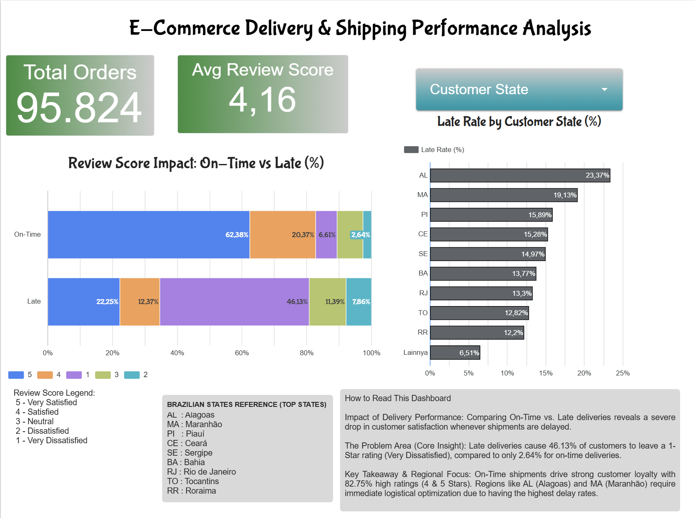

# 📦 E-Commerce Delivery & Shipping Performance Analysis (Olist Dataset)

An end-to-end data analytics and business intelligence project analyzing logistics delivery performance and its direct impact on customer satisfaction across **95,824** e-commerce orders in Brazil.

🔗 **Live Interactive Dashboard:** [Open in Google Looker Studio](https://datastudio.google.com/reporting/b19b9802-19f9-41a8-bbd7-9d488013bfef)

---

## 📊 Dashboard Preview

---

## 🎯 Business Problem & Objectives
Customer retention in e-commerce relies heavily on timely order fulfillment. This project investigates:
1. Overall shipping efficiency across 99,441 raw order records.
2. Regional bottlenecks identifying Brazilian states with the highest late delivery rates.
3. Quantitative correlation between delivery delays and customer review scores (1 to 5 stars).

---

## 🛠️ Tech Stack & Methodology
* **Data Cleaning & Feature Engineering:** Python (`Pandas`, `NumPy`) in Google Colab — filtered 99,441 raw records down to 96,470 delivered orders and 95,824 valid reviewed orders (`olist_delivery_analysis_clean.csv`).
* **Exploratory Data Analysis (EDA):** Statistical correlation analysis (`Pearson r = -0.24`) and regional aggregation.
* **Data Visualization:** Google Looker Studio interactive dashboard with dynamic state filtering.

---

## 🔍 Key Analytical Findings
* **Severe Satisfaction Drop on Late Orders:** Late deliveries trigger a **46.13%** rate of 1-star reviews (Very Dissatisfied), compared to only **2.64%** for on-time shipments.
* **On-Time Loyalty Driver:** On-time deliveries generate **82.75%** high satisfaction ratings (combination of 62.38% 5-star and 20.37% 4-star reviews), maintaining an overall platform rating of **4.16 / 5.00**.
* **Regional Bottlenecks:** Northeastern states experience the highest logistics delays, led by **Alagoas (AL) at 23.37%**, **Maranhão (MA) at 19.13%**, and **Piauí (PI) at 15.89%**.

---

## 📁 Repository Structure
* `Olist_Delivery_EDA.ipynb` — Complete Python notebook covering data ingestion, cleaning, feature engineering, and EDA.
* `olist_delivery_analysis_clean.csv` — Cleaned dataset ready for BI visualization.
* `olist-dashboard.jpg` — Snapshot of the final Looker Studio dashboard.

---

## 👤 Author
**Mursyid, S.Kom.**  
Data Analyst & Web Developer  
* GitHub: [@mursyidproject](https://github.com/mursyidproject)
